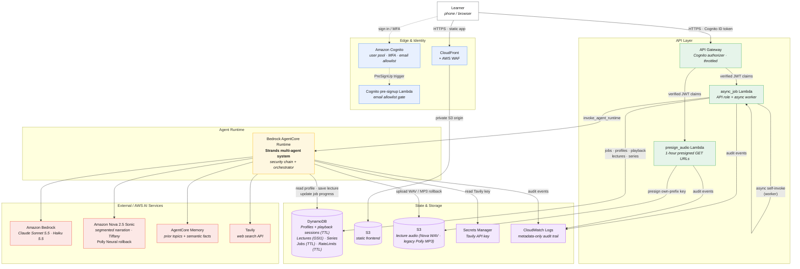
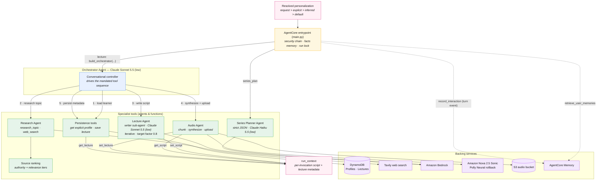
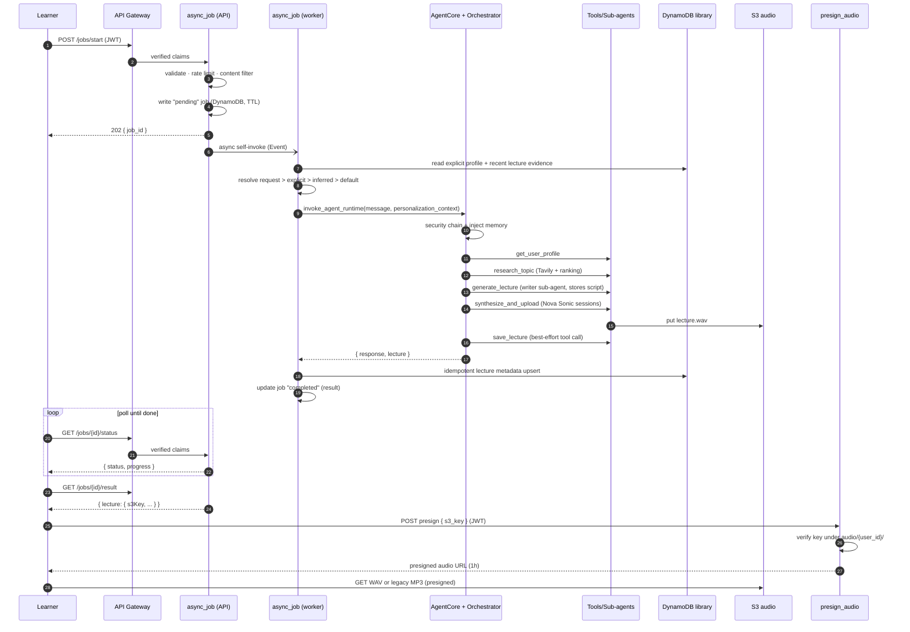
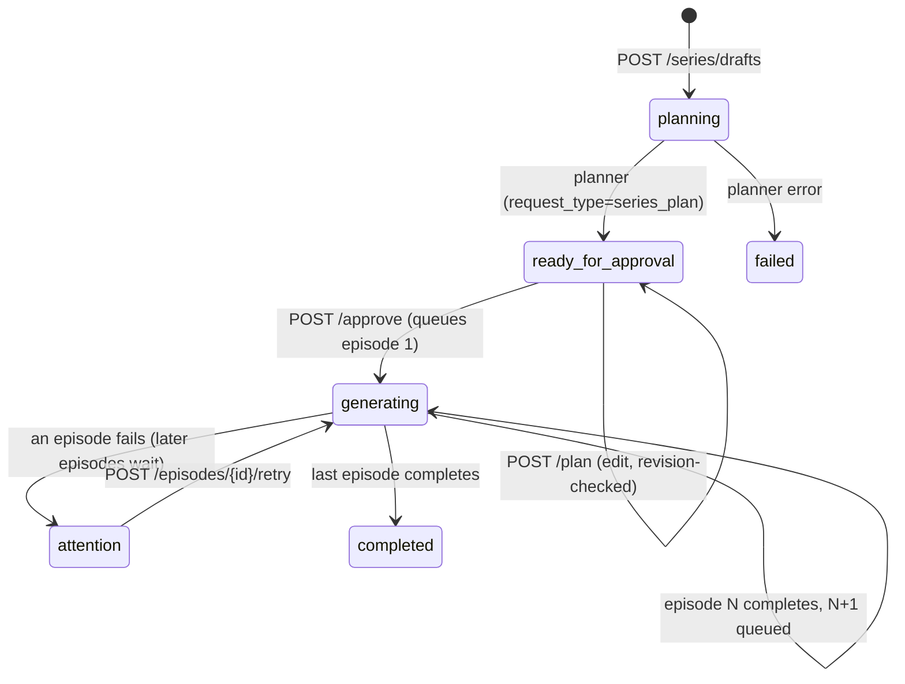
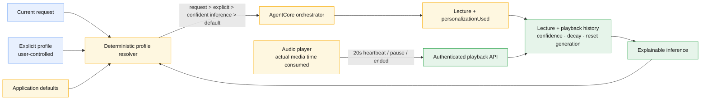

# Architecture

The Audio Learning Companion is a personalized audio-learning web app built on a
**Strands multi-agent system** running inside **Amazon Bedrock AgentCore**, fronted by
a hardened AWS serverless stack. A learner asks to be taught a topic; the system
researches it, writes a lecture tailored to their knowledge level and learning style,
synthesizes it to speech, and serves it back for playback.

This document covers five views:

1. [System architecture](#1-system-architecture) — the deployed AWS topology.
2. [Multi-agent architecture](#2-multi-agent-architecture) — orchestration and specialist agents.
3. [Lecture request lifecycle](#3-lecture-request-lifecycle) — one asynchronous lecture run.
4. [Multi-part lecture series](#4-multi-part-lecture-series) — durable sequential generation.
5. [Adaptive learner profile](#5-adaptive-learner-profile) — explicit settings, playback evidence, inference, and privacy.

For endpoint request/response contracts, see [API.md](./API.md).

---

## 1. System architecture

Static application traffic is served through CloudFront and WAF. The browser calls the
API Gateway endpoint directly; every API route is authenticated with a Cognito ID token,
CORS-restricted to the CloudFront origin, and throttled before reaching Lambda. Lecture
generation is **asynchronous**: the API accepts a job, returns immediately, and a worker
drives the long-running AgentCore run in the background.



### Deployment units

The repository produces two independently deployed compute units:

1. **CDK stack** — CloudFront/WAF, Cognito, API Gateway, Lambdas, DynamoDB, S3,
   Secrets Manager, AgentCore Memory, alarms, and budgets.
2. **AgentCore runtime** — packaged from `agentcore/` and referenced by ARN from the
   async Lambda environment.

The React build is uploaded to the CDK-managed frontend bucket. For shared contract
changes, deploy AgentCore first (backward-compatible payload handling), then the CDK
stack/Lambdas, then the frontend. See [DEPLOYMENT.md](./DEPLOYMENT.md).

### Security chain

Both the `async_job` Lambda (before a job is enqueued) and the AgentCore entrypoint
(before the agent runs) apply the same defense-in-depth sequence, so the runtime is safe
even if invoked directly:

```
validate input  ->  rate limit  ->  content filter  ->  invoke agent  ->  audit log
```

- **Input validation** — length/format checks; prompt-injection patterns are logged (not
  blocked). User ids and job ids must be canonical UUIDs.
- **Rate limiting** — per-user, per-action hourly buckets in DynamoDB (fails open).
- **Content filter** — narrow blocklist (CSAM, WMD/explosives how-tos, malware creation);
  legitimate sensitive topics are intentionally allowed.
- **Audit logging** — one JSON line per event to CloudWatch, **metadata only** via a strict
  key allowlist — never message content, lecture text, or search queries.

Identity is never trusted from the request body: the `user_id` always comes from the
verified Cognito JWT (`requestContext.authorizer.claims.sub`), and audio keys are scoped to
`audio/{user_id}/...` so a user can only ever presign their own files. WAF protects the
CloudFront-hosted web application; API Gateway independently protects the direct API path
with Cognito authorization, request throttling, restrictive CORS, and per-user application
rate limits.

---

## 2. Multi-agent architecture

The **orchestrator** is the conversational controller (Claude Sonnet 5.5, low effort).
It never writes the lecture or produces audio itself—its job is to coordinate. Each specialist capability is
exposed to it as a **Strands tool**; some of those tools are themselves agent-backed
(`generate_lecture` spins up a dedicated writer sub-agent). A shared, per-invocation
`run_context` carries the large lecture script and final metadata between tools without
round-tripping through the orchestrator LLM.



### The agents

Model IDs below are evaluated defaults. Runtime environment overrides can select an
available fallback; the current live account uses Sonnet 4.6 for text roles while its
5.5 profiles remain unavailable for invocation.

| Agent / tool | Model | Responsibility |
|---|---|---|
| **Orchestrator** | `us.anthropic.claude-sonnet-5-5` (low, between-tools) | Conversational controller. Loads the profile, then drives the fixed tool sequence; never teaches directly and never claims completion without a real `s3Key`. |
| **Research Agent** | — (Tavily API) | Runs several varied search "angles" (quick/standard/deep = 3/5/8 queries), deduplicates, and ranks sources by domain **authority** blended with **relevance**. Optional trusted-only mode keeps academic/reference/encyclopedic tiers. |
| **Series Planner Agent** | `us.anthropic.claude-haiku-5-5` (low, thinking off) | Produces a validated 2–8 episode JSON plan only. It never researches, writes lecture prose, or synthesizes audio. |
| **Lecture Agent** | `us.anthropic.claude-sonnet-5-5` (low, target factor 0.8) | Composes spoken prose iteratively and stores the full script in `run_context`. The calibrated target corrects model verbosity while preserving requested spoken duration. |
| **Audio Agent** | — (Nova 2.5 Sonic; Polly rollback) | Splits prose into ≤900-word sentence-aligned sessions (~6 minutes each), streams each through Nova with Tiffany, retries a failed session without publishing partial audio, adds short faded joins, and uploads one 24 kHz PCM WAV to `audio/{user_id}/{lecture_id}/lecture.wav`. `NARRATION_PROVIDER=polly` restores Neural Joanna MP3 generation. |
| **Persistence tools** | — (DynamoDB) | `get_user_profile` supplies user-declared context and `save_lecture` persists history. Profile writes are authenticated API operations—not model-controlled tool calls. |

Nova sessions are individually bounded to 180 seconds with at most two attempts, and
the complete narration has a 660-second deadline. This leaves time for research,
writing, upload, and trusted persistence inside Lambda's 15-minute / AgentCore's
870-second synchronous envelope.

### Why `run_context`?

Long lecture scripts (tens of thousands of characters) must not be passed back through the
orchestrator LLM as tool arguments — that risks truncation and wastes tokens. Instead the
Lecture Agent writes the script to `run_context` (`set_script`), and the Audio Agent reads
it directly (`get_script`). The entrypoint holds a lock around the whole run and resets the
context each invocation, so a plain module-level store is safe.

### Long-term memory

`AgentCore Memory` gives cross-session recall. Before the run, the entrypoint retrieves the
learner's relevant long-term memories (prior topics and semantic facts, scoped to
`users/{user_id}/...`) and injects them into the orchestrator's system prompt. After the
run, the turn is recorded as an event, from which AgentCore asynchronously extracts new
long-term records. Memory **fails open** — if it's disabled or errors, the agent still runs
using just the DynamoDB profile.

---

## 3. Lecture request lifecycle

An end-to-end "teach me X" lecture request, from tap to playback:



### Live generation progress

`invoke_agent_runtime` is synchronous from Lambda's perspective, so the waiting Lambda
cannot observe internal tool execution. Instead, the validated AgentCore entrypoint binds
the trusted `job_id`, user id, and optional claim token, and tools publish best-effort,
monotonic updates directly to the owned Jobs row. The AgentCore role receives scoped
access to update JobsTable, upload under the audio prefix, and invoke Nova Sonic.

| Progress band | Stage | Real completion signal |
|---:|---|---|
| 0–20% | Queue, validation, memory | Worker claimed; request validated; semantic context retrieved |
| 25% | Personalization | Explicit learner profile loaded |
| 30–44% | Research | Each Tavily search angle completed; sources ranked |
| 45–69% | Writing | Initial draft and any continuation/closing passes completed |
| 70–88% | Speech synthesis | Each real Nova session (or Polly rollback segment) completed |
| 90–93% | Upload | WAV/MP3 upload started/completed |
| 94–95% | Save | Lecture persisted to the user's library |
| 98–100% | Finalize | Worker validated response, persisted result, and completed job |

`stageSeq` prevents late lower-stage writes. Flat workers and series planners use fencing
tokens; series episode UI reads stage data from the active job while keeping episode
lifecycle state (`queued`, `processing`, `completed`, `failed`) separate. Progress is a
set of operation landmarks—not an estimate of elapsed time.

---

## 4. Multi-part lecture series

Long subjects (for example a book across 4 × 30-minute lectures) are planned once,
reviewed by the learner, then generated **one episode at a time**. Each episode is a
normal lecture from the unchanged orchestrator pipeline (research → write → narrate →
save), so a series adds coordination, not a second lecture implementation.



- **Durable state** lives in `SeriesTable`: summaries at `pk=USER#{userId}`,
  `sk=SERIES#{seriesId}`; ordered episodes at `pk=SERIES#{seriesId}`,
  `sk=EPISODE#{nn}`. Work items are `SERIES_PLAN` / `SERIES_EPISODE` rows in the
  existing JobsTable, run by the same async worker Lambda (routed by `jobType`;
  rows without `jobType` are flat lecture jobs, unchanged).
- **Idempotency and recovery**: flat jobs, planners, and episode workers claim only
  `pending` rows, so at-least-once redelivery cannot replace healthy active work.
  Planner tokens and episode `activeJobId` conditions fence final transitions; duplicate
  or late workers cannot enqueue the next episode twice. Episode completion and queueing
  the next episode happen in one transaction. If audio succeeds but that transaction
  fails, a retry can leave an orphaned audio object; production exactly-once recovery
  would require reconciliation by `episodeId`.
- **Failure and retry**: a failed episode pauses the series (`attention`) with a
  user-safe error. Retry is allowed for a failed episode, or when the active job's
  progress heartbeat has been stale for the lease interval, and creates a new job. The
  sequence then resumes without replacing a healthy long-running narration.
- **Planner**: `agentcore/agents/series_planner.py` returns strict JSON (2–8 episodes,
  1–30 minutes each). It honors an explicit count/length in the request and never
  generates a lecture.
- **Episode requests** include the series title, the episode's focus, and the full
  outline so each lecture stays in scope and links to its neighbors. AgentCore tags
  the saved lecture row with `seriesId`, `episodeId`, and `episodeOrder`.
- **Suggestions are advisory**: Chat has an explicit Lecture/Series choice. An explicit
  multi-lecture request in Lecture mode asks before doing anything. After a broad
  topic (book, history, deep dive) produces one lecture, Chat offers a series. The
  app never converts a request on its own.

Step Functions is intentionally not used yet. The API and schema keep the runner
replaceable, and the current agent loop could later move to AgentCore Harness
episode by episode.

---

## 5. Adaptive learner profile

The learner model separates declared settings from behavioral evidence. Explicit
settings are stored at `ProfilesTable: USER#{userId} / PROFILE#EXPLICIT`; temporary
playback-session checkpoints use `PLAYBACK#{lectureId}#{sessionId}` and expire after
seven days via TTL. Durable listening aggregates remain on the learner-owned lecture
row.



- **Signals**: generated topics contribute weak interest evidence; ≥80% actual
  listening contributes duration/style/depth evidence. Old evidence decays over a
  180-day horizon. At least three independent samples and 70% confidence are required
  before an inference can affect generation.
- **Playback integrity**: the client accumulates media time consumed from wall-clock
  playback time × playback rate. Seeking does not count. Cumulative session updates
  carry sequence numbers and occurrence timestamps, are serialized/retried by the
  client, and are conditionally transacted with the profile revision and lecture
  aggregate. Duplicate delivery cannot double-count, and delayed pre-reset events
  cannot cross into a newer inference generation.
- **Privacy**: behavioral personalization can be disabled. Reset or consent changes
  atomically advance an `inferenceGeneration`; playback transactions are revision-fenced
  and write only to the active generation. Older or delayed evidence therefore remains
  permanently excluded without deleting factual playback progress/history. Explicit
  settings always remain visible and authoritative.
- **Observability**: each generated lecture stores `personalizationUsed`, including
  the value, source (`current_request`, `explicit`, `inferred`, or `default`), and
  confidence. AgentCore Memory remains supplemental semantic context rather than the
  preference source of truth.

### DynamoDB data model

| Table | Key shape | Purpose / lifecycle |
|---|---|---|
| Profiles | `USER#{userId}` / `PROFILE#EXPLICIT` | Revisioned, user-authored settings plus consent and active inference generation; durable. |
| Profiles | `USER#{userId}` / `PLAYBACK#{lectureId}#{sessionId}` | Sequence checkpoint for idempotent playback ingestion; seven-day TTL. |
| Lectures | `USER#{userId}` / `LECTURE#{lectureId}` | Durable playback metadata, `personalizationUsed`, listening aggregates, and optional series tags; `GSI1(pk, createdAt)` supports newest-first history. |
| Series | `USER#{userId}` / `SERIES#{seriesId}` | Durable series summary, revision, progress, and planner fencing token. |
| Series | `SERIES#{seriesId}` / `EPISODE#{order}` | Ordered episode plan and generation state; durable. |
| Jobs | `jobId` | Flat lecture, series-plan, and series-episode work records; 24-hour TTL. |
| RateLimits | `USER#{userId}` / action bucket | Per-user action counters; two-hour TTL. |

All user-facing reads begin with the verified Cognito subject. No endpoint accepts an
authoritative user id from request JSON. See [API.md](./API.md) for contracts and status
transitions.

### Consistency boundaries

- **Profile edits** use one strongly consistent snapshot and optimistic `revision`
  checks; stale cross-device saves return `409`.
- **Playback ingestion** atomically checks the active profile revision, advances the
  per-session sequence, and updates the lecture aggregate. Client retries are safe.
- **Inference privacy** uses generation-specific counters. Reset, disable, and re-enable
  advance the generation so older, opted-out, or delayed evidence cannot reappear.
- **Lecture completion** requires the trusted worker's deterministic metadata upsert
  before a job is marked complete.
- **Series planning** uses claim-token fencing across Jobs and Series rows; episode
  completion and queueing the next episode are one transaction.

---

## Where things live

| Path | What |
|------|------|
| `agentcore/main.py` | AgentCore entrypoint + security chain + memory wiring |
| `agentcore/agents/orchestrator.py` | Orchestrator agent and the mandated tool sequence |
| `agentcore/agents/{research,lecture,audio}_agent.py` | Specialist sub-agents/tools |
| `agentcore/agents/{profile_store,memory,run_context,research_ranking,config}.py` | Persistence, memory, shared context, ranking, config/model ids |
| `agentcore/security/` | Input validation, rate limiting, content filter, audit logging |
| `lambdas/async_job/` | Job API + async worker; `series.py` coordinates lecture series and `learner_profile.py` handles explicit profiles, playback, and inference |
| `agentcore/agents/series_planner.py` | Strict-JSON lecture-series planner |
| `lambdas/presign_audio/` | Own-prefix presigned audio URLs |
| `infrastructure/` | AWS CDK v2 (Python) — all cloud resources |
| `frontend/` | React 19 + TypeScript + Vite PWA |
| `ARCHITECTURE.md` | Topology, agent graph, lifecycles, data model, and consistency boundaries |
| `API.md` | Authenticated endpoint contracts and errors |
| `DEPLOYMENT.md` / `RUNBOOK.md` | Deployment, validation, operations, recovery, and erasure |
