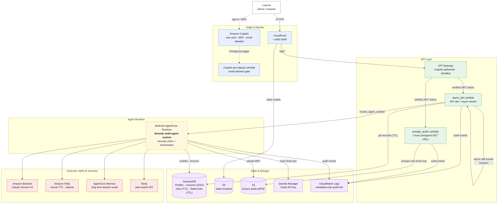
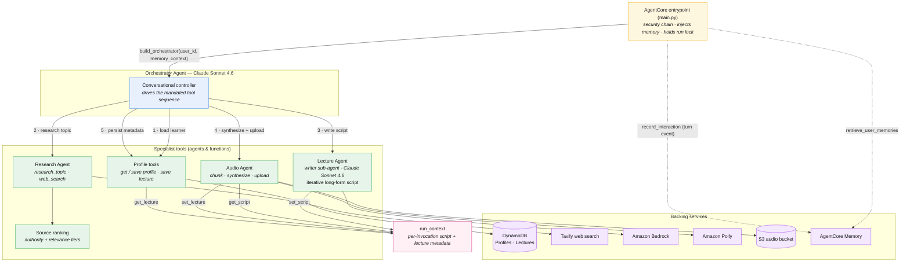
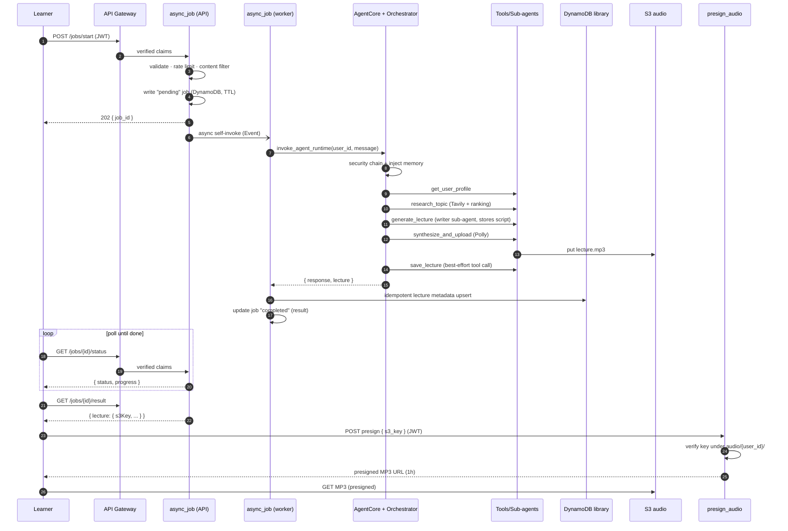
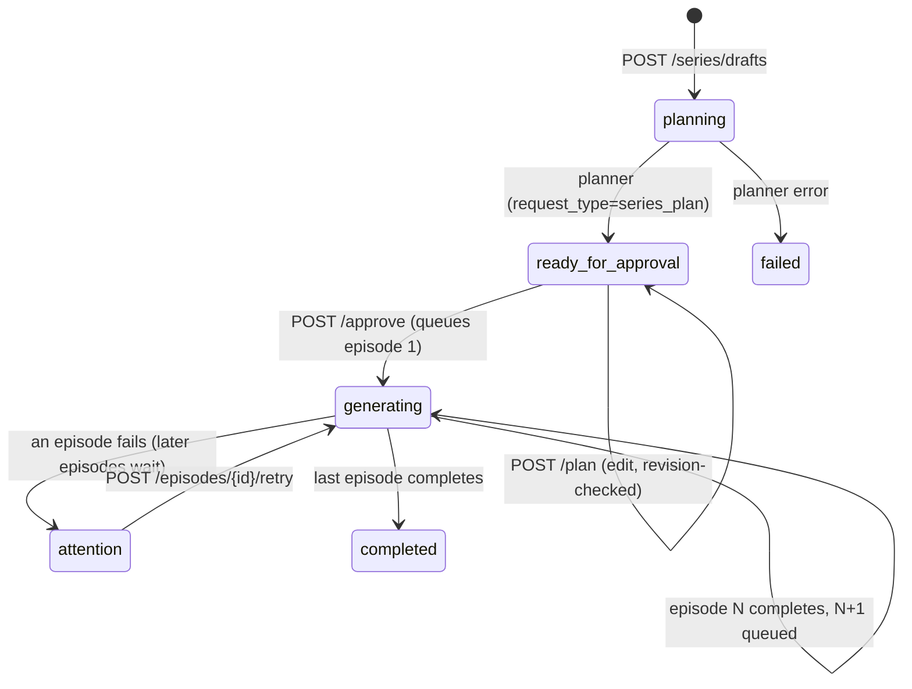
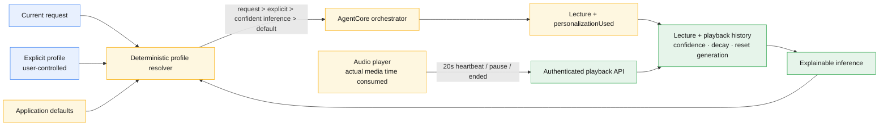

# Architecture

The Audio Learning Companion is a personalized audio-learning web app built on a
**Strands multi-agent system** running inside **Amazon Bedrock AgentCore**, fronted by
a hardened AWS serverless stack. A learner asks to be taught a topic; the system
researches it, writes a lecture tailored to their knowledge level and learning style,
synthesizes it to speech, and serves it back for playback.

This document covers three views:

1. [System architecture](#1-system-architecture) — the end-to-end AWS design.
2. [Multi-agent architecture](#2-multi-agent-architecture) — the orchestrator and its
   specialist sub-agents.
3. [Request lifecycle](#3-request-lifecycle) — how one "teach me X" request flows through
   the whole system.

---

## 1. System architecture

Every request is authenticated with a Cognito JWT (email-allowlisted, MFA-enforced) and
passes through WAF and a throttled API Gateway before reaching any compute. Lecture
generation is **asynchronous**: the API accepts a job, returns immediately, and a worker
drives the long-running agent run in the background.



### Security chain

Both the `async_job` Lambda (before a job is enqueued) and the AgentCore entrypoint
(before the agent runs) apply the same defense-in-depth sequence, so the runtime is safe
even if invoked directly:

```
validate input  ->  rate limit  ->  content filter  ->  invoke agent  ->  audit log
```

- **Input validation** — length/format checks; prompt-injection patterns are logged (not
  blocked). User ids and job ids must be canonical UUIDs.
- **Rate limiting** — per-user, per-action hourly buckets in DynamoDB (fails open).
- **Content filter** — narrow blocklist (CSAM, WMD/explosives how-tos, malware creation);
  legitimate sensitive topics are intentionally allowed.
- **Audit logging** — one JSON line per event to CloudWatch, **metadata only** via a strict
  key allowlist — never message content, lecture text, or search queries.

Identity is never trusted from the request body: the `user_id` always comes from the
verified Cognito JWT (`requestContext.authorizer.claims.sub`), and audio keys are scoped to
`audio/{user_id}/...` so a user can only ever presign their own files.

---

## 2. Multi-agent architecture

The **orchestrator** is the conversational brain (Claude Sonnet 4.6). It never writes the
lecture or produces audio itself — its job is to coordinate. Each specialist capability is
exposed to it as a **Strands tool**; some of those tools are themselves agent-backed
(`generate_lecture` spins up a dedicated writer sub-agent). A shared, per-invocation
`run_context` carries the large lecture script and final metadata between tools without
round-tripping through the orchestrator LLM.



### The agents

| Agent / tool | Model | Responsibility |
|---|---|---|
| **Orchestrator** | `us.anthropic.claude-sonnet-4-6` | Conversational controller. Loads the profile, then drives the fixed tool sequence; never teaches directly and never claims completion without a real `s3Key`. |
| **Research Agent** | — (Tavily API) | Runs several varied search "angles" (quick/standard/deep = 3/5/8 queries), deduplicates, and ranks sources by domain **authority** blended with **relevance**. Optional trusted-only mode keeps academic/reference/encyclopedic tiers. |
| **Lecture Agent** | `us.anthropic.claude-sonnet-4-6` | Spins up a dedicated writer sub-agent that composes the spoken-word script **iteratively** (continuation passes) to reliably hit the target length (~150 wpm), then stores the full script in `run_context`. |
| **Audio Agent** | — (Amazon Polly neural) | Splits the script on sentence boundaries into ≤3000-char chunks, synthesizes each with Polly (Joanna), concatenates the MP3 frames, and uploads to `audio/{user_id}/{lecture_id}/lecture.mp3`. |
| **Profile tools** | — (DynamoDB) | `get_user_profile` / `save_user_profile` / `save_lecture`. Persist learner preferences and lecture history, always scoped to the verified `user_id`. |

### Why `run_context`?

Long lecture scripts (tens of thousands of characters) must not be passed back through the
orchestrator LLM as tool arguments — that risks truncation and wastes tokens. Instead the
Lecture Agent writes the script to `run_context` (`set_script`), and the Audio Agent reads
it directly (`get_script`). The entrypoint holds a lock around the whole run and resets the
context each invocation, so a plain module-level store is safe.

### Long-term memory

`AgentCore Memory` gives cross-session recall. Before the run, the entrypoint retrieves the
learner's relevant long-term memories (prior topics and semantic facts, scoped to
`users/{user_id}/...`) and injects them into the orchestrator's system prompt. After the
run, the turn is recorded as an event, from which AgentCore asynchronously extracts new
long-term records. Memory **fails open** — if it's disabled or errors, the agent still runs
using just the DynamoDB profile.

---

## 3. Request lifecycle

An end-to-end "teach me X" lecture request, from tap to playback:



---

## 4. Multi-part lecture series

Long subjects (for example a book across 4 × 30-minute lectures) are planned once,
reviewed by the learner, then generated **one episode at a time**. Each episode is a
normal lecture from the unchanged orchestrator pipeline (research → write → Polly →
save), so a series adds coordination, not a second lecture implementation.



- **Durable state** lives in `SeriesTable`: summaries at `pk=USER#{userId}`,
  `sk=SERIES#{seriesId}`; ordered episodes at `pk=SERIES#{seriesId}`,
  `sk=EPISODE#{nn}`. Work items are `SERIES_PLAN` / `SERIES_EPISODE` rows in the
  existing JobsTable, run by the same async worker Lambda (routed by `jobType`;
  rows without `jobType` are flat lecture jobs, unchanged).
- **Idempotency**: every transition is a conditional DynamoDB transaction keyed on
  the episode's `activeJobId`. A duplicate or late worker delivery cannot claim the
  same episode or enqueue the next one twice. Episode completion and queueing the
  next episode happen in one transaction. If audio succeeds but that transaction
  fails, a retry can leave an orphaned audio object; production exactly-once recovery
  would require reconciliation by `episodeId`.
- **Failure and retry**: a failed episode pauses the series (`attention`) with a
  user-safe error. Retry is allowed for a failed episode, or one stalled longer than
  the 15-minute worker timeout, and creates a new job. The sequence then resumes.
- **Planner**: `agentcore/agents/series_planner.py` returns strict JSON (2–8 episodes,
  1–30 minutes each). It honors an explicit count/length in the request and never
  generates a lecture.
- **Episode requests** include the series title, the episode's focus, and the full
  outline so each lecture stays in scope and links to its neighbors. AgentCore tags
  the saved lecture row with `seriesId`, `episodeId`, and `episodeOrder`.
- **Suggestions are advisory**: Chat has an explicit Lecture/Series choice. An explicit
  multi-lecture request in Lecture mode asks before doing anything. After a broad
  topic (book, history, deep dive) produces one lecture, Chat offers a series. The
  app never converts a request on its own.

Step Functions is intentionally not used yet. The API and schema keep the runner
replaceable, and the current agent loop could later move to AgentCore Harness
episode by episode.

---

## 5. Behavioral learner profile

The learner model separates declared settings from behavioral evidence. Explicit
settings are stored at `ProfilesTable: USER#{userId} / PROFILE#EXPLICIT`; temporary
playback-session checkpoints use `PLAYBACK#{lectureId}#{sessionId}` and expire after
seven days via TTL. Durable listening aggregates remain on the learner-owned lecture
row.



- **Signals**: generated topics contribute weak interest evidence; ≥80% actual
  listening contributes duration/style/depth evidence. Old evidence decays over a
  180-day horizon. At least three independent samples and 70% confidence are required
  before an inference can affect generation.
- **Playback integrity**: the client accumulates media time consumed from wall-clock
  playback time × playback rate. Seeking does not count. Cumulative session updates
  are sequence-numbered and conditionally transacted with the lecture aggregate, so
  duplicate delivery cannot double-count.
- **Privacy**: behavioral personalization can be disabled. Reset or consent changes
  atomically advance an `inferenceGeneration`; playback transactions are revision-fenced
  and write only to the active generation. Older or delayed evidence therefore remains
  permanently excluded without deleting factual playback progress/history. Explicit
  settings always remain visible and authoritative.
- **Observability**: each generated lecture stores `personalizationUsed`, including
  the value, source (`current_request`, `explicit`, `inferred`, or `default`), and
  confidence. AgentCore Memory remains supplemental semantic context rather than the
  preference source of truth.

---

## Where things live

| Path | What |
|------|------|
| `agentcore/main.py` | AgentCore entrypoint + security chain + memory wiring |
| `agentcore/agents/orchestrator.py` | Orchestrator agent and the mandated tool sequence |
| `agentcore/agents/{research,lecture,audio}_agent.py` | Specialist sub-agents/tools |
| `agentcore/agents/{profile_store,memory,run_context,research_ranking,config}.py` | Persistence, memory, shared context, ranking, config/model ids |
| `agentcore/security/` | Input validation, rate limiting, content filter, audit logging |
| `lambdas/async_job/` | Job API + async worker; `series.py` coordinates lecture series and `learner_profile.py` handles explicit profiles, playback, and inference |
| `agentcore/agents/series_planner.py` | Strict-JSON lecture-series planner |
| `lambdas/presign_audio/` | Own-prefix presigned audio URLs |
| `infrastructure/` | AWS CDK v2 (Python) — all cloud resources |
| `frontend/` | React 19 + TypeScript + Vite PWA |
